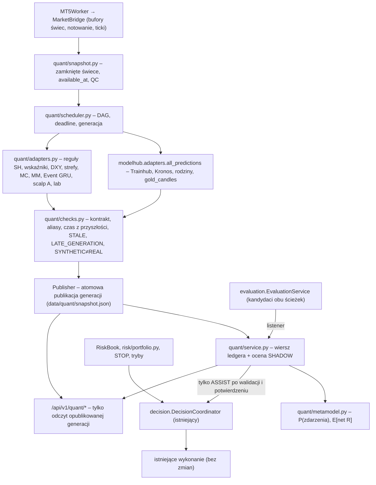

# PMW Quant Core – architektura (1.35.0)

Quant Core rozbudowuje istniejący backend `masterquo`. Nie zastępuje modeli jedną siecią. Nie tworzy drugiego koordynatora ani drugiej ścieżki zleceń.
Kod znajduje się w `backend/masterquo/quant/`. Wspólny kontrakt zostaje w `modelhub/contract.py` (PMW-PRED-2), ocena setupu w `evaluation/`, decyzja w `decision/`.

## Przepływ (rzeczywiste wywołania)

## Odpowiedzialności i właściciele zadań

| Zadanie DAG | Właściciel | Co robi | Deadline |
|---|---|---|---|
| `snapshot` | `quant.snapshot` | odczyt buforów bridge (`include_forming=False`), QC, `revision_id`, `snapshot_id` | 5 s |
| `base_predictions` | `modelhub.adapters` | dotychczasowe `all_predictions()`; rodziny liczą się raz na świecę we własnym cache `FamilyService` | 20 s |
| `extended_predictions` | `quant.adapters` | adaptery spoza `all_predictions()`; **czyta** cache usług-właścicieli (MM, SH, wskaźniki, strefy, lab, MC) | 25 s |
| `contract_checks` | `quant.checks` | deduplikacja aliasów, walidator PMW-PRED-2, czas, świeżość, typ danych | 5 s |

Zasada jednego właściciela: jeśli model ma własny cykl (pętla MM co zamkniętą M5, kontekst SH, wskaźniki PMW-IND-1, pętla lab), adapter tylko czyta jego wynik. Quant liczy sam wyłącznie modele, które nie miały cyklu:

- **Event GRU** (`mm:event_engine_dir3`). W 1.33 rodzina `SEQ_GRU_EVENT` zwracała `None`, a usługa MM tylko wypisywała artefakt. Ścieżka inferencji nie istniała. Teraz Quant liczy go co cykl z aktywnego artefaktu wskaźnika MM, na tym samym źródle zdarzeń, na którym był trenowany (manifest `event_source`). `FamilyService.predict("SEQ_GRU_EVENT")` czyta ten wynik, ale tylko gdy jest `READY`.
- **Scalp zadanie A**. Wcześniej liczone wyłącznie na żądanie panelu. Teraz jedno wywołanie procesu `.venv_candles` przypada na zamkniętą świecę M1.

Rejestracja zadania pod innym właścicielem jest odrzucana (`OwnershipError`). Cykle zależności są odrzucane (`CycleError`).
Zadanie po deadline ma stan `TIMEOUT`, a jego późny wynik nie trafia do nowszej generacji. `Publisher` odrzuca generację starszą od bieżącej.
Błąd zadania blokuje tylko zależne od niego zadania (`BLOCKED_DEPENDENCY`).

## Wątki i obciążenie

- `QuantService` działa we własnym wątku `quant-core`, co `cycle_s` (domyślnie 5 s), niezależnie od panelu. Test: `test_quant_core.TestService`, `test_ui_quant.test_01`.
- API czyta wyłącznie opublikowaną generację. Odświeżanie panelu nie uruchamia cyklu ani treningu.
- Koordynator nie liczy modeli. W trybie ASSIST czyta opublikowaną generację i wykonuje iloczyn skalarny meta-modelu (mikrosekundy, zob. `PERFORMANCE.md`).
- Trening meta-modelu to wątek `quant-train` uruchamiany wyłącznie jawnie (CLI / POST `/api/v1/quant/jobs`). Nigdy nie aktywuje modelu.

## Tryby (`data/quant/settings.json`)

| Tryb | Skutek |
|---|---|
| `OFF` | brak cyklu i wierszy ledgera; koordynator jak w 1.34 |
| `SHADOW` (domyślny) | cykl, ledger, oceny bez wpływu; `DecisionCoordinator._preds()` = rodziny jak dotąd (zgodność wykonawcza – test `TestCoordinatorQuant.test_off_and_shadow_parity`) |
| `ASSIST` | wymaga aktywnego artefaktu `VALIDATED_SHADOW` **i** jawnego potwierdzenia (`--confirm` / `confirm: true`). Koordynator czyta sprawdzoną generację, a wpis `quant:metamodel` może tylko **wstrzymać** kandydata (`MODEL_QUANT_HOLD`) |

ASSIST nie tworzy ścieżki zleceń, nie podnosi limitów i nie zamienia WAIT w ENTER. Działa wyłącznie przez istniejące `evaluate_models` i `final_verdict`.
STOP, rezerwacje `RiskBook`, limity portfela, związanie rachunku i rekonsyliacja pozostają bez zmian.
Moduł `quant/` nie importuje wykonania ani bramki zleceń (test statyczny `test_quant_has_no_order_path`).
`quant:metamodel` można wpisać do `decision.required_models`; wtedy brak wyniku blokuje wejście zgodnie z istniejącą logiką REQUIRED.

## Zmiany istniejących modułów (1.35)

| Plik | Zmiana |
|---|---|
| `decision/coordinator.py` | czas danych z przyszłości nie jest już wiekiem 0 (`MODEL_REQUIRED_FUTURE_TIME`, ASSIST bez wpływu); identyfikator na granicy = rodzina / `model_id` / kanoniczny (nigdy `?`); wpis Quant tylko w ASSIST; `quant_hold` → `MODEL_QUANT_HOLD` |
| `sh/service.py` | `MODEL_QUANT_HOLD` traktowany jak blokada REQUIRED (READY → WAIT) |
| `evaluation/engine.py` | PMW-EVAL-ENGINE-2: usunięto przedział Wilsona z liczności kalibracji jako niepewność p(x) |
| `evaluation/service.py` | lista `listeners` (Quant) po zapisie oceny |
| `modelhub/families/service.py` | `SEQ_GRU_EVENT` odczytuje wynik Event GRU z Quant (tylko READY) |
| `runtime.py` | utworzenie, powiązanie, start i stop `QuantService` |
| `api/app.py` | router `/api/v1/quant/*` |
| `__main__.py` | `python -m masterquo quant ...` |
| `frontend/.../QuantSection.tsx` | sekcja w Koordynatorze decyzji i w Centrum treningu |

## Dane na dysku (addytywnie, bez migracji bazy)

`<dane>/quant/settings.json`, `<dane>/quant/ledger.sqlite`, `<dane>/quant/snapshot.json`, `<dane>/quant/models/<instrument>/<task_hash>/<wersja>/{model.json,manifest.json}`, `<dane>/quant/models/<instrument>/ACTIVE.json`, `<dane>/quant/jobs/*.json`.
Baza `masterquo.db` i jej migracje nie zmieniły się. Usunięcie katalogu `quant` przywraca stan 1.34 (zob. `ROLLBACK.md`).
